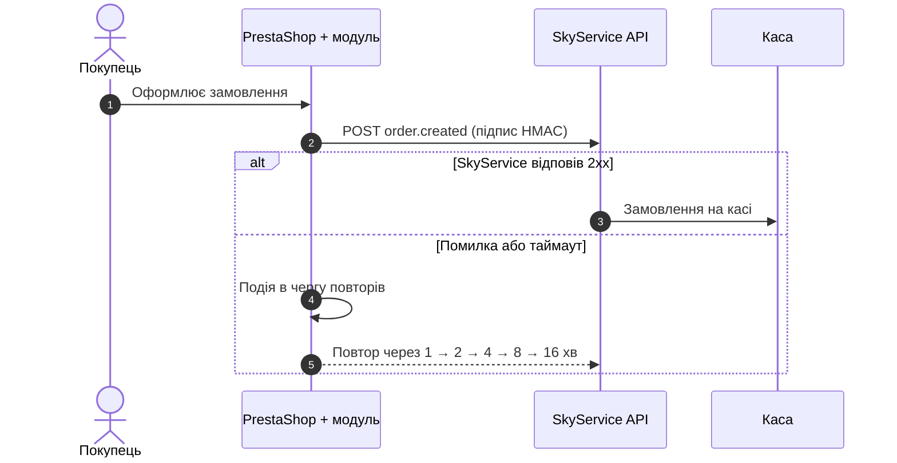

<div align="center">


# SkyService для PrestaShop

**Замовлення з інтернет-магазину — одразу на касі SkyService POS**


[Завантажити](#install) · [Налаштування](#setup) · [Як це працює](#how) · [Релізи](#releases)

</div>

---

## 📦 Про модуль

PrestaShop не вміє надсилати вихідні вебхуки, тому без модуля касі лишається тільки
періодично опитувати магазин — і замовлення приходять із затримкою. Модуль **SkyService**
ловить підтвердження замовлення прямо в магазині й миттєво передає його в SkyService POS.

Модуль навмисно «тонкий»: він відповідає лише за доставку замовлень. Каталог, ціни,
залишки та звʼязки товарів синхронізує сам SkyService через Webservice API магазину —
тож оновлювати модуль на хостингу доводиться рідко.

## ✨ Можливості

| | |
|---|---|
| ⚡ **Миттєва передача** | Нове замовлення зʼявляється на касі в момент підтвердження |
| 🔄 **Статуси** | Скасування та повернення передаються, щоб SkyService повернув залишок |
| 🔐 **Підпис HMAC-SHA256** | Кожен запит підписаний секретом — підробити замовлення неможливо |
| 🛟 **Черга повторів** | Якщо SkyService недоступний, подія не губиться, а доставляється пізніше |
| 🛒 **Checkout не страждає** | Таймаут 5 с і повна ізоляція помилок — покупець завжди оформить замовлення |
| 🧪 **Перевірка зʼєднання** | Одна кнопка в налаштуваннях показує, чи все підключено правильно |

## 📋 Вимоги

- PrestaShop **8.0** або новіший (перевірено на 9.1)
- PHP з розширенням **cURL**
- Активна підписка SkyService з підключеною інтеграцією PrestaShop

<a id="install"></a>

## 🚀 Встановлення

1. Завантажте **`skyservice.zip`** з [останнього релізу](../../releases/latest).
2. В адмінці магазину відкрийте **Модулі → Менеджер модулів → Завантажити модуль**.
3. Перетягніть архів у вікно — PrestaShop встановить модуль автоматично.

> [!NOTE]
> Архів не потрібно розпаковувати. Для оновлення просто завантажте новий `skyservice.zip`
> тим самим способом — налаштування збережуться.

<a id="setup"></a>

## ⚙️ Налаштування

1. У SkyService відкрийте інтеграцію **PrestaShop** і підключіть магазин
   (адреса магазину + ключ Webservice).
2. Видайте **секрет модуля** — SkyService покаже три значення:
   **URL API**, **ID компанії**, **Секрет**.
3. У магазині: **Модулі → SkyService → Налаштувати**, вставте ці значення та увімкніть модуль.
4. Натисніть **«Перевірити зʼєднання»** — має зʼявитися повідомлення про успіх.

> [!TIP]
> Залиште поле «Секрет» порожнім під час збереження, якщо не хочете його змінювати.
> Після перевипуску секрету в SkyService обовʼязково вставте новий у модуль —
> доти замовлення не прийматимуться.

<a id="how"></a>

## 🧭 Як це працює



| Подія магазину | Подія SkyService | Навіщо |
|---|---|---|
| `actionValidateOrder` | `order.created` | Замовлення підтверджене — має зʼявитися на касі |
| `actionOrderStatusPostUpdate` | `order.status_updated` | Скасування / повернення — повернути залишок |
| кнопка в налаштуваннях | `ping` | Перевірка зʼєднання |

Кожен запит містить заголовки `X-Sky-Event`, `X-Sky-Signature`
(`base64(hmac_sha256(body, secret))`), `X-Sky-Source` та `X-Sky-Module-Version`.
Стан черги повторів видно на сторінці налаштувань модуля.

Технічні деталі для розробників — у [docs/DEVELOPMENT.md](docs/DEVELOPMENT.md).

<a id="releases"></a>

## 🏷 Релізи

Кожен пуш у гілку `main` автоматично збирає модуль і публікує
[GitHub Release](../../releases) з архівом `skyservice.zip`.

- Версія береться з `skyservice/config.xml` і має збігатися з `$this->version`
  у `skyservice/skyservice.php` — інакше збірка зупиниться.
- Нова версія → реліз `vX.Y.Z`.
- Версію не змінено → реліз `vX.Y.Z-build.N`, щоб жодна зміна не загубилася.

Щоб випустити нову версію, підніміть номер в обох файлах і запуште в `main`.

## 📁 Структура репозиторію

```text
.
├── skyservice/              # сам модуль — саме ця тека потрапляє в zip
│   ├── skyservice.php       # основний клас модуля
│   ├── config.xml           # метадані та версія
│   ├── logo.png
│   └── upgrade/             # скрипти оновлення між версіями
├── docs/DEVELOPMENT.md      # технічні нотатки, локальний стенд
└── .github/workflows/       # автоматичний реліз
```

## 💬 Підтримка

Питання щодо підключення та роботи модуля — до служби підтримки SkyService
через ваш особистий кабінет.

## ⚖️ Ліцензія

© 2026 SkyService. **Усі права захищено.**

Це пропрієтарне програмне забезпечення. Копіювання, поширення, модифікація та
використання поза сервісом SkyService без письмового дозволу заборонені.
Повний текст — у файлі [LICENSE](LICENSE).
